# Informe de laboratorio: Programación Cuántica con Qiskit

Simulación en Ubuntu con Qiskit 1.4.6 y Qiskit Aer 0.18.4 (comprobación en `evidencias/entorno.txt`). Cada circuito se ejecutó en el simulador ideal de Aer. Las figuras se guardaron en disco, sin abrir una ventana gráfica.

## Práctica 1. Estado de Bell

### Objetivo

Preparar el estado de Bell $\lvert\Phi^+\rangle = (\lvert00\rangle + \lvert11\rangle)/\sqrt{2}$, medir ambos cúbits y comprobar que los resultados salen correlacionados: solo aparecen `00` y `11`, cada uno cerca del 50 %.

### Código

Programa: `lab1_hola_mundo.py`.

```python
qc = QuantumCircuit(2, 2)
qc.h(0)
qc.cx(0, 1)
qc.measure([0, 1], [0, 1])
```

Hadamard sobre q0 crea $(\lvert00\rangle + \lvert10\rangle)/\sqrt{2}$. La CNOT con control en q0 y objetivo en q1 entrelaza las dos ramas y deja $(\lvert00\rangle + \lvert11\rangle)/\sqrt{2}$. Se simularon 10 000 disparos.

### Diagrama e histograma

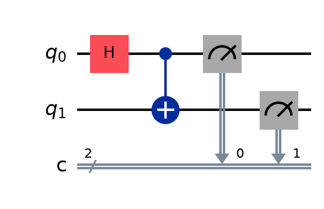


Salida de la terminal: `evidencias/lab1/terminal.png` y texto en `evidencias/lab1/salida.txt`.


### Esperado frente a obtenido

| Estado | Esperado | Obtenido (10 000 disparos) |
| --- | --- | --- |
| $\lvert00\rangle$ | ~50 % | 5035 (50.35 %) |
| $\lvert01\rangle$ | 0 % | 0 (0.00 %) |
| $\lvert10\rangle$ | 0 % | 0 (0.00 %) |
| $\lvert11\rangle$ | ~50 % | 4965 (49.65 %) |

### Conclusión

La medición reproduce el estado de Bell. Cada cúbit por separado es aleatorio, pero los dos resultados coinciden siempre: no hubo ni un solo `01` ni `10`. La desviación respecto al 50 % es de 0.35 puntos porcentuales, del orden del error binomial de 10 000 disparos.

## Práctica 2. Rotaciones en la esfera de Bloch

### Objetivo

Barrir el ángulo θ de la compuerta Ry y comprobar que la probabilidad de medir 0 sigue $P(\lvert0\rangle) = \cos^2(\theta/2)$ y la de medir 1 sigue $P(\lvert1\rangle) = \sin^2(\theta/2)$.

### Código

Programa: `lab2_rotaciones_bloch.py`.

```python
qc = QuantumCircuit(1, 1)
qc.ry(theta, 0)
qc.measure(0, 0)
```

La guía pide cuatro ángulos (0, π/4, π/2 y π). El mismo circuito se repitió en 17 ángulos entre 0 y π, con 10 000 disparos en cada uno, para dibujar la curva completa. Las barras de error son la desviación estándar binomial.

### Diagrama y gráfica

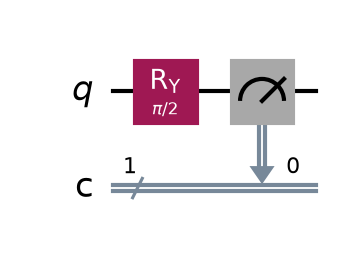

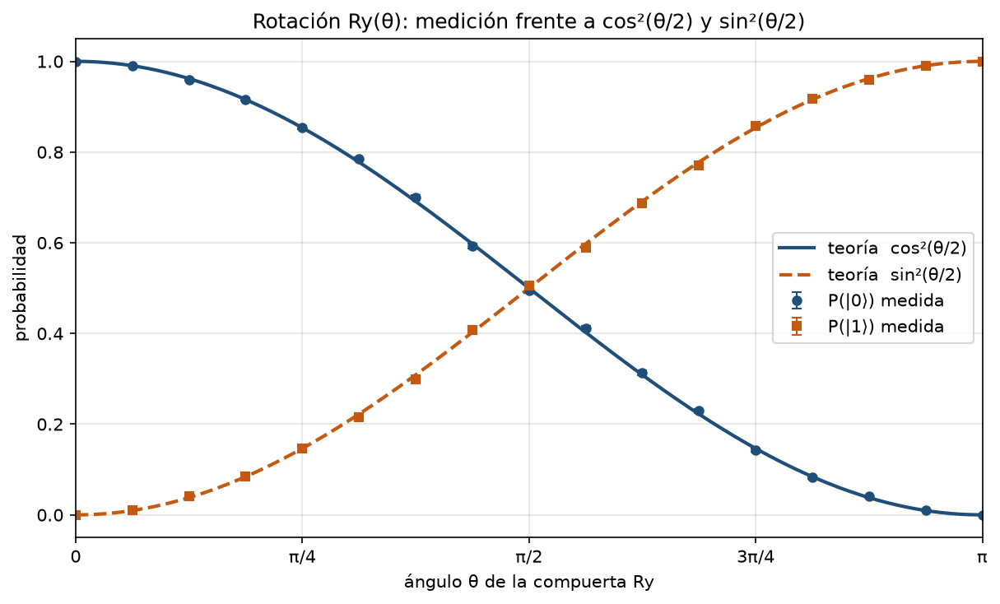

Salida de la terminal: `evidencias/lab2/terminal.png` y texto en `evidencias/lab2/salida.txt`.

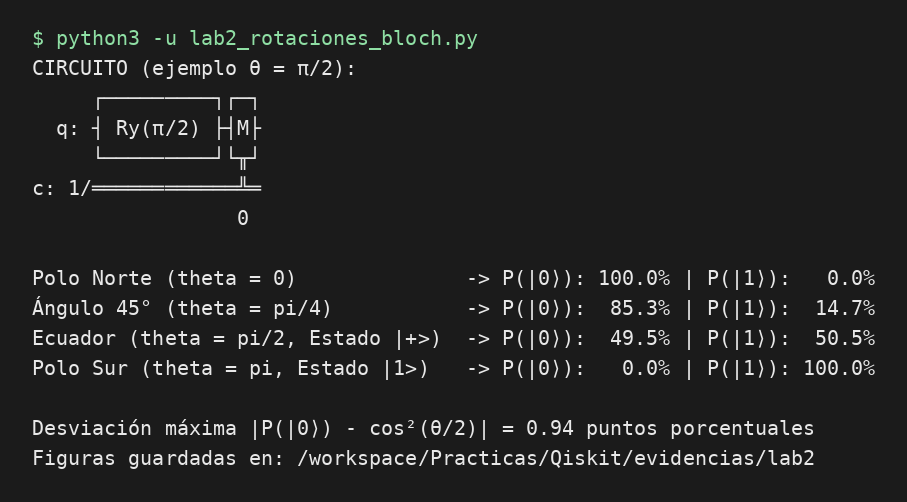

### Esperado frente a obtenido

| Ángulo | Teoría P(0) / P(1) | Medición P(0) / P(1) |
| --- | --- | --- |
| 0 (polo norte) | 100 % / 0 % | 100.0 % / 0.0 % |
| π/4 | 85.4 % / 14.6 % | 85.3 % / 14.7 % |
| π/2 (ecuador, $\lvert+\rangle$) | 50 % / 50 % | 49.5 % / 50.5 % |
| π (polo sur, $\lvert1\rangle$) | 0 % / 100 % | 0.0 % / 100.0 % |

En los 17 ángulos, la mayor diferencia entre P(0) medida y $\cos^2(\theta/2)$ fue 0.94 puntos porcentuales.

A 45° el valor analítico es $\cos^2(\pi/8) = (1 + 1/\sqrt{2})/2 \approx 0.8536$ (85.4 %). La corrida dio 85.3 %.

### Conclusión

Los puntos medidos caen sobre las curvas $\cos^2(\theta/2)$ y $\sin^2(\theta/2)$. En los polos el resultado es exacto, porque Ry(0) no cambia $\lvert0\rangle$ y Ry(π) lo lleva a $\lvert1\rangle$. En el resto, la diferencia cabe en el ruido de muestreo de 10 000 disparos.

## Práctica 3. Algoritmo de Deutsch

### Objetivo

Decidir si una función booleana $f:\{0,1\}\to\{0,1\}$ es constante o balanceada con una sola consulta al oráculo. En un ordenador clásico hacen falta dos consultas.

### Código

Programa: `lab3_algoritmo_deutsch.py`.

Los cuatro oráculos:

```python
# constante_0:          f(x) = 0      (identidad)
# constante_1:          f(x) = 1      (X sobre la ancilla)
# balanceada_identidad: f(x) = x      (CNOT)
# balanceada_inversa:   f(x) = NOT x  (X, CNOT, X sobre q0)
```

El circuito de Deutsch prepara la ancilla en $\lvert1\rangle$, aplica Hadamard a los dos cúbits (q0 queda en $\lvert+\rangle$ y q1 en $\lvert-\rangle$), consulta el oráculo una vez, vuelve a aplicar Hadamard a q0 y lo mide. Se usaron 1 000 disparos por oráculo.

### Diagrama e histograma

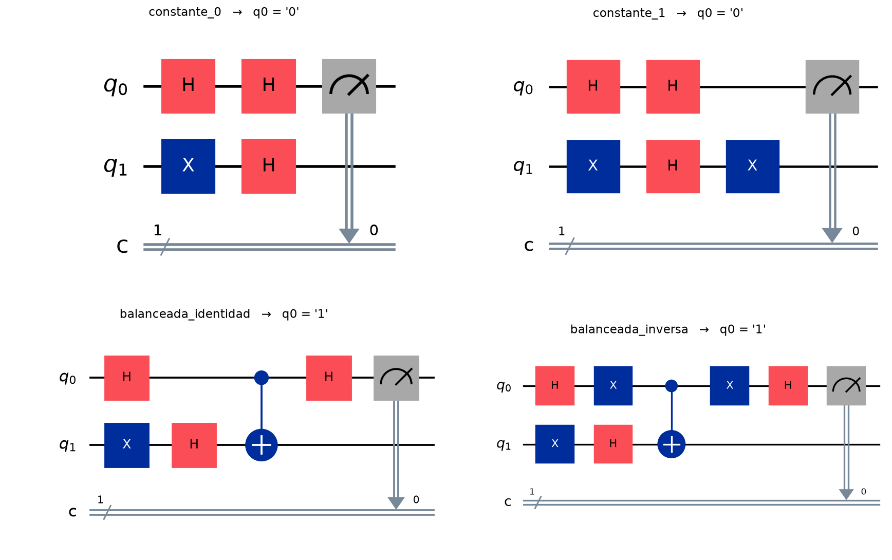

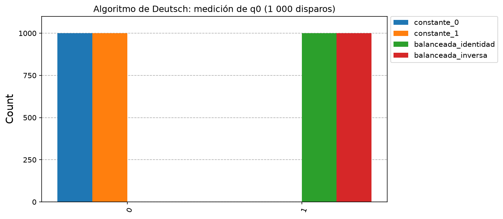

Salida de la terminal: `evidencias/lab3/terminal.png` y texto en `evidencias/lab3/salida.txt`.

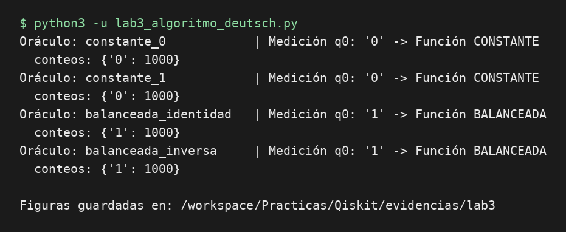

### Esperado frente a obtenido

| Oráculo | Esperado | Obtenido |
| --- | --- | --- |
| constante_0 | q0 = 0, constante | `'0'` en 1000/1000, CONSTANTE |
| constante_1 | q0 = 0, constante | `'0'` en 1000/1000, CONSTANTE |
| balanceada_identidad | q0 = 1, balanceada | `'1'` en 1000/1000, BALANCEADA |
| balanceada_inversa | q0 = 1, balanceada | `'1'` en 1000/1000, BALANCEADA |

### Conclusión

Con la ancilla en $\lvert-\rangle$, el oráculo escribe $f(x)$ como fase relativa $(-1)^{f(x)}$ sobre q0 (phase kickback). Si $f(0)=f(1)$ esa fase es global y el segundo Hadamard devuelve 0. Si $f(0)\neq f(1)$ la fase es relativa y el segundo Hadamard devuelve 1. Los cuatro casos salieron deterministas, sin un solo disparo en el bit contrario.

## Práctica 4. Teletransportación cuántica

### Objetivo

Teletransportar el estado $\mathrm{Ry}(\pi/3)\lvert0\rangle$ desde el cúbit de Alice (q0) hasta el de Bob (q2). Ese estado vale $(\sqrt{3}/2)\lvert0\rangle + (1/2)\lvert1\rangle$, así que al medirlo debe dar cerca de 75 % de ceros y 25 % de unos.

### Código

Programa: `lab4_teletransportacion.py`.

```python
qc.ry(math.pi / 3, 0)   # estado a teletransportar
qc.h(1)
qc.cx(1, 2)             # par de Bell entre Alice (q1) y Bob (q2)
qc.cx(0, 1)
qc.h(0)                 # Alice mide en la base de Bell
qc.measure(0, 0)
qc.measure(1, 1)
qc.cx(1, 2)             # si q1 quedó en 1, Pauli-X sobre Bob
qc.cz(0, 2)             # si q0 quedó en 1, Pauli-Z sobre Bob
qc.measure(2, 2)
```

Tras medir q0 y q1, esos cúbits quedan en el estado clásico que se acaba de leer. La CNOT y la CZ posteriores aplican entonces la corrección de Bob condicionada a esos bits. El bit de Bob es el más significativo de la cadena (`bitstring[0]`, registro c2). Se usaron 10 000 disparos.

### Diagrama e histograma

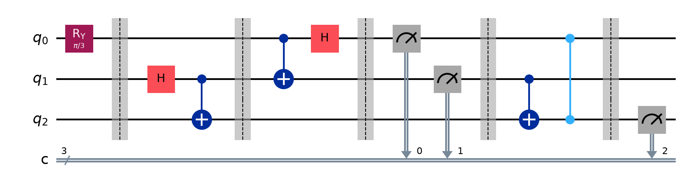

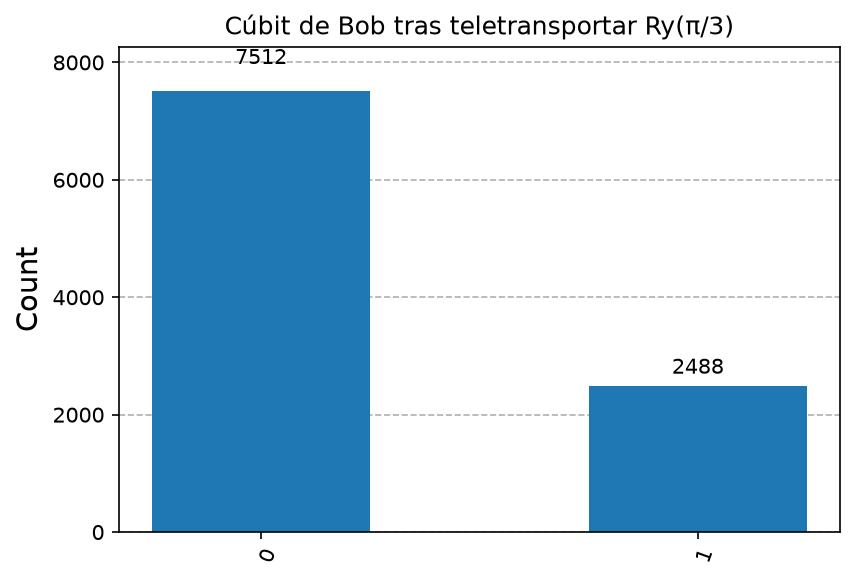

Salida de la terminal: `evidencias/lab4/terminal.png` y texto en `evidencias/lab4/salida.txt`.


### Esperado frente a obtenido

| Medición en Bob (q2) | Teórico | Obtenido (10 000 disparos) |
| --- | --- | --- |
| P(0) | 75.00 % | 75.12 % (7512) |
| P(1) | 25.00 % | 24.88 % (2488) |

### Conclusión

Bob recupera las probabilidades del estado que Alice preparó en q0. La diferencia con el 75 % / 25 % es de 0.12 puntos porcentuales. El estado no se copió: Alice lo consume al medir, y Bob lo reconstruye con el par entrelazado y los dos bits clásicos.

## Cuestionario (sección 8 de la guía)

### 1. ¿Por qué un Hadamard sobre $\lvert0\rangle$ da 50 % de probabilidad y el estado sigue siendo puro?

Hadamard transforma $\lvert0\rangle$ en

$$
\lvert+\rangle = \frac{\lvert0\rangle + \lvert1\rangle}{\sqrt{2}}.
$$

La probabilidad de cada resultado es el módulo al cuadrado de su amplitud, y $\lvert 1/\sqrt{2}\rvert^2 = 1/2$. El estado sigue siendo puro porque es un solo vector: toda la información está en las dos amplitudes y en la fase relativa entre ellas, que aquí es cero. No es una mezcla clásica «50 % $\lvert0\rangle$ y 50 % $\lvert1\rangle$». En esa mezcla la fase no existe y un segundo Hadamard seguiría dando 50 %. Sobre $\lvert+\rangle$, el segundo Hadamard interfiere y devuelve $\lvert0\rangle$ con probabilidad 1. Esa interferencia es la firma de que el estado era puro.

### 2. En $(\lvert00\rangle + \lvert11\rangle)/\sqrt{2}$, si el primer cúbit sale 1, ¿cuál es la probabilidad de que el segundo salga 0?

Cero.

El estado solo tiene amplitud en $\lvert00\rangle$ y $\lvert11\rangle$. Medir 1 en el primer cúbit descarta $\lvert00\rangle$ y proyecta el registro en $\lvert11\rangle$. El segundo cúbit queda en $\lvert1\rangle$ con probabilidad 1, así que la probabilidad de que colapse en 0 es exactamente 0. En la práctica 1, de 10 000 disparos, los estados `01` y `10` aparecieron 0 veces.

### 3. Reto 1. Estado $\lvert\Psi^+\rangle = (\lvert01\rangle + \lvert10\rangle)/\sqrt{2}$

Hay que intercalar una compuerta Pauli-X en el cúbit 1, después de la CNOT. Partiendo del $\lvert\Phi^+\rangle$ de la práctica 1, esa X cambia $\lvert00\rangle$ por $\lvert10\rangle$ y $\lvert11\rangle$ por $\lvert01\rangle$.

Programa: `reto1_bell_psi_plus.py`.

```python
qc.h(0)
qc.cx(0, 1)
qc.x(1)   # |Φ+⟩ → |Ψ+⟩
qc.measure([0, 1], [0, 1])
```

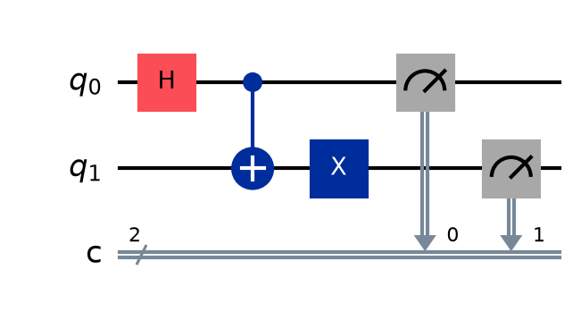

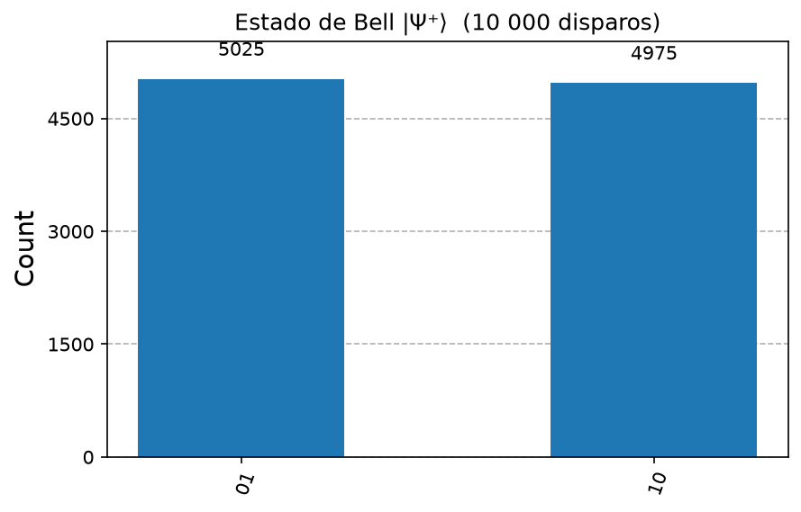

| Estado | Esperado | Obtenido (10 000 disparos) |
| --- | --- | --- |
| $\lvert00\rangle$ | 0 % | 0 (0.00 %) |
| $\lvert01\rangle$ | ~50 % | 5025 (50.25 %) |
| $\lvert10\rangle$ | ~50 % | 4975 (49.75 %) |
| $\lvert11\rangle$ | 0 % | 0 (0.00 %) |

El histograma queda en `01` y `10`. La compuerta que se intercala es Pauli-X y el cúbit es el q1.

### 4. Reto 2. Deutsch sin la X de la ancilla

Si no se aplica X a q1 antes del Hadamard, la ancilla no llega a $\lvert-\rangle$: sigue en $\lvert0\rangle$ y el Hadamard la deja en $\lvert+\rangle$.

El oráculo cumple $U_f\lvert x\rangle\lvert y\rangle = \lvert x\rangle\lvert y \oplus f(x)\rangle$. Sobre $\lvert+\rangle = (\lvert0\rangle + \lvert1\rangle)/\sqrt{2}$ eso no cambia nada, tanto si $f(x)=0$ como si $f(x)=1$:

$$
U_f\lvert x\rangle\lvert+\rangle = \lvert x\rangle\lvert+\rangle.
$$

No aparece la fase $(-1)^{f(x)}$. El phase kickback necesita $\lvert-\rangle$, que es el autoestado de la X con autovalor −1; $\lvert+\rangle$ tiene autovalor +1 y la función no deja rastro en q0. q0 se queda en $\lvert+\rangle$ para cualquier oráculo y el Hadamard final lo manda siempre a $\lvert0\rangle$. Constantes y balanceadas se vuelven indistinguibles.

Programa: `reto2_deutsch_sin_x.py`. Se omitió `qc.x(1)` y se repitieron los cuatro oráculos (1 000 disparos).

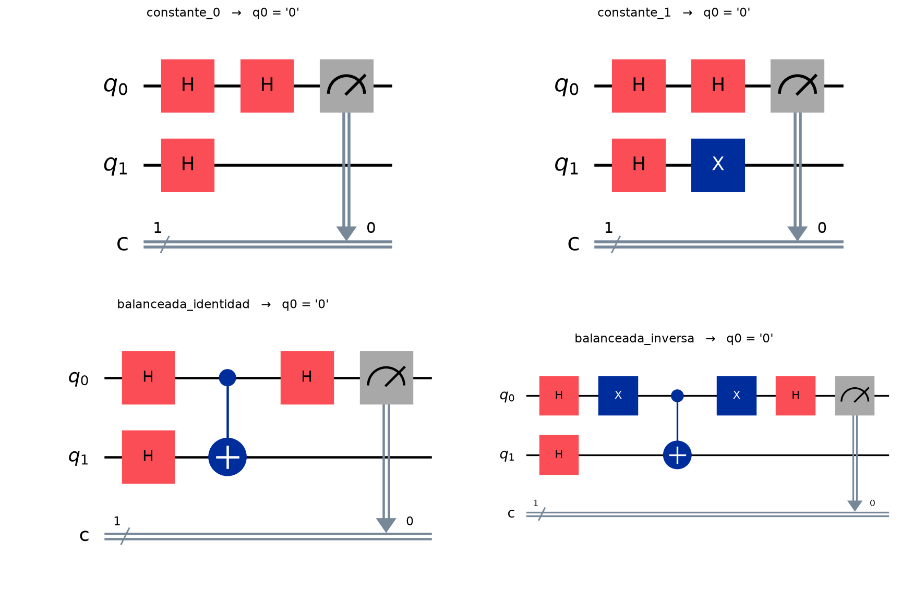

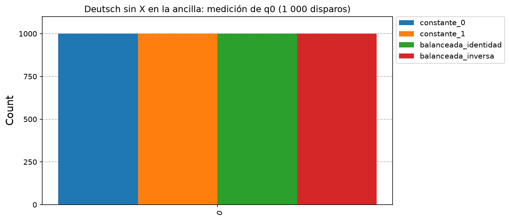

| Oráculo | Medición de q0 | Lectura del algoritmo |
| --- | --- | --- |
| constante_0 | `'0'` en 1000/1000 | diría CONSTANTE |
| constante_1 | `'0'` en 1000/1000 | diría CONSTANTE |
| balanceada_identidad | `'0'` en 1000/1000 | diría CONSTANTE, y se equivoca |
| balanceada_inversa | `'0'` en 1000/1000 | diría CONSTANTE, y se equivoca |

Las dos funciones balanceadas, que en la práctica 3 daban 1 con 1000/1000, aquí dan 0 con 1000/1000. Sin la X no hay phase kickback y el algoritmo pierde la ventaja de la consulta única.

### 5. ¿Por qué la teletransportación no envía información más rápido que la luz?

El entrelazamiento correlaciona a Alice y a Bob, pero Bob no puede leer el estado teletransportado hasta recibir los dos bits clásicos.

Alice obtiene uno de cuatro resultados, cada uno con probabilidad 1/4, y no elige cuál. Antes de que lleguen esos bits, el cúbit de Bob es una mezcla uniforme de $\lvert\psi\rangle$, $X\lvert\psi\rangle$, $Z\lvert\psi\rangle$ y $XZ\lvert\psi\rangle$. Esa mezcla es $I/2$: no depende de $\lvert\psi\rangle$. En este laboratorio $\lvert\psi\rangle = \mathrm{Ry}(\pi/3)\lvert0\rangle$ tiene 75 % / 25 %, y Bob solo ve esas cifras después de aplicar la X y la Z según los bits de Alice (práctica 4: 75.12 % y 24.88 %). Sin los bits, su estadística local no cambia aunque Alice mida.

Esos dos bits viajan por un canal clásico, como máximo a la velocidad de la luz. El entrelazamiento reparte correlaciones; no lleva un mensaje por sí solo. Por eso el protocolo no es superlumínico y tampoco clona $\lvert\psi\rangle$: Alice lo destruye al medir.
