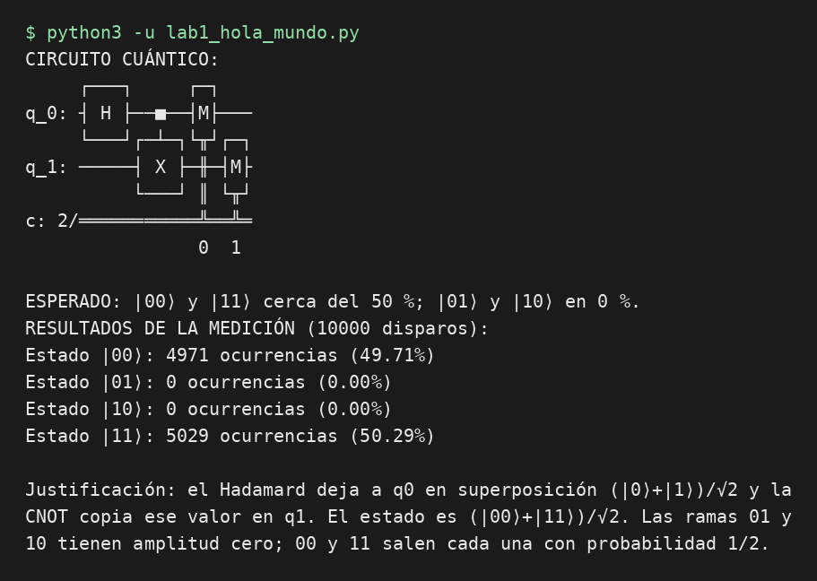
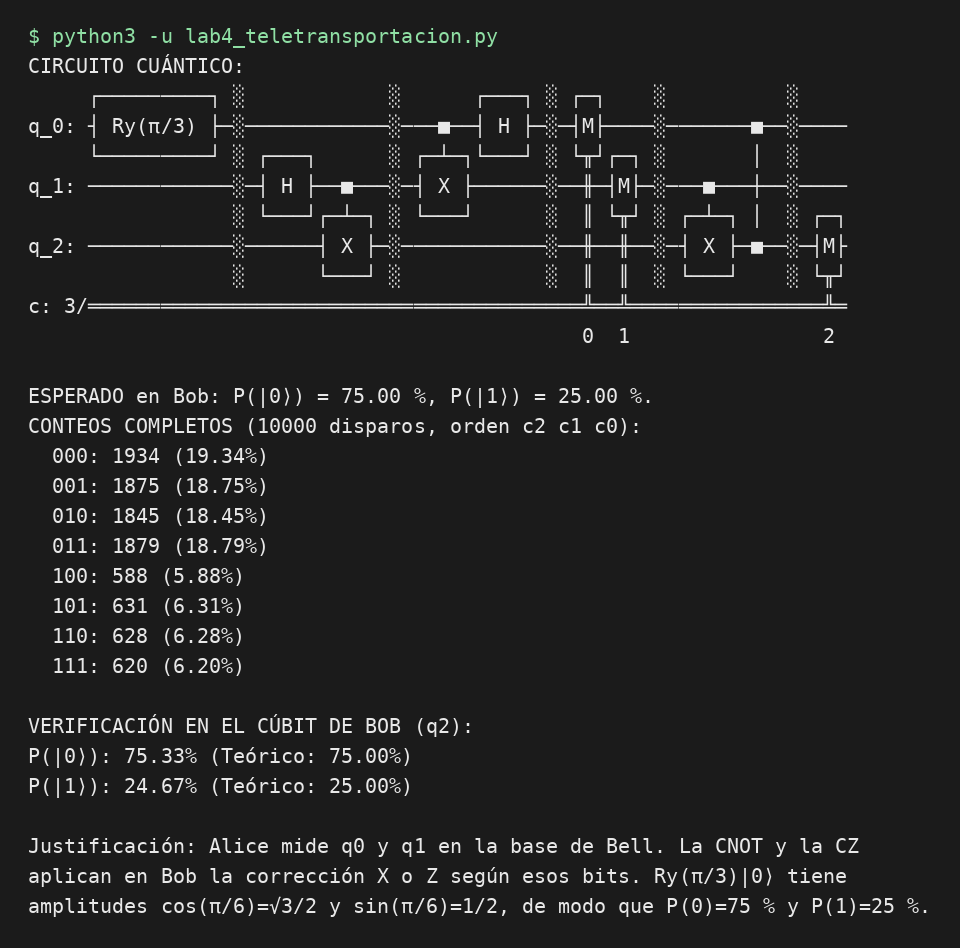
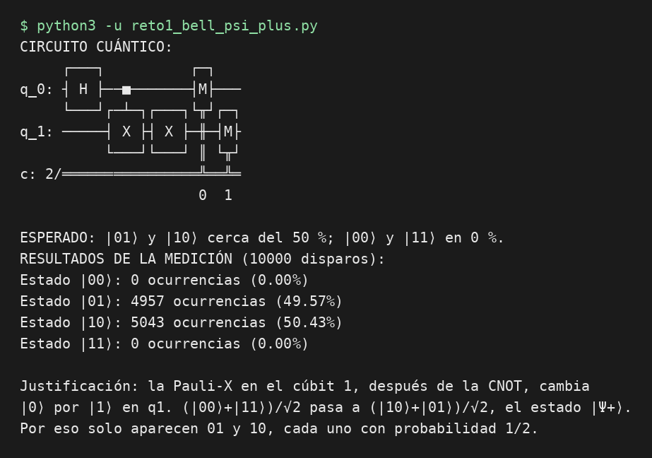
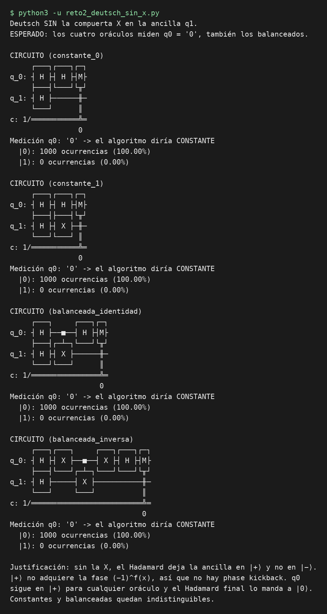

# Informe de laboratorio: Programación Cuántica con Qiskit

Simulación en Ubuntu con Qiskit 1.4.6 y Qiskit Aer 0.18.4 (comprobación en `evidencias/entorno.txt`). Cada circuito se ejecutó en el simulador ideal de Aer. Los programas solo escriben en la consola: el circuito en texto, los conteos, el valor teórico y una justificación.

## Práctica 1. Estado de Bell

### Objetivo

Preparar el estado de Bell $\lvert\Phi^+\rangle = (\lvert00\rangle + \lvert11\rangle)/\sqrt{2}$, medir ambos cúbits y comprobar que solo aparecen `00` y `11`, cada uno cerca del 50 %.

### Código

Programa: `lab1_hola_mundo.py`.

```python
qc = QuantumCircuit(2, 2)
qc.h(0)
qc.cx(0, 1)
qc.measure([0, 1], [0, 1])
```

Hadamard sobre q0 crea $(\lvert00\rangle + \lvert10\rangle)/\sqrt{2}$. La CNOT con control en q0 y objetivo en q1 entrelaza las dos ramas y deja $(\lvert00\rangle + \lvert11\rangle)/\sqrt{2}$. Se simularon 10 000 disparos.

### Salida de consola

```text
CIRCUITO CUÁNTICO:
     ┌───┐     ┌─┐   
q_0: ┤ H ├──■──┤M├───
     └───┘┌─┴─┐└╥┘┌─┐
q_1: ─────┤ X ├─╫─┤M├
          └───┘ ║ └╥┘
c: 2/═══════════╩══╩═
                0  1 

ESPERADO: |00⟩ y |11⟩ cerca del 50 %; |01⟩ y |10⟩ en 0 %.
RESULTADOS DE LA MEDICIÓN (10000 disparos):
Estado |00⟩: 4971 ocurrencias (49.71%)
Estado |01⟩: 0 ocurrencias (0.00%)
Estado |10⟩: 0 ocurrencias (0.00%)
Estado |11⟩: 5029 ocurrencias (50.29%)

Justificación: el Hadamard deja a q0 en superposición (|0⟩+|1⟩)/√2 y la
CNOT copia ese valor en q1. El estado es (|00⟩+|11⟩)/√2. Las ramas 01 y
10 tienen amplitud cero; 00 y 11 salen cada una con probabilidad 1/2.
```

Captura de esa misma ejecución: `evidencias/lab1/terminal.png`.



### Esperado frente a obtenido

| Estado | Esperado | Obtenido (10 000 disparos) |
| --- | --- | --- |
| $\lvert00\rangle$ | ~50 % | 4971 (49.71 %) |
| $\lvert01\rangle$ | 0 % | 0 (0.00 %) |
| $\lvert10\rangle$ | 0 % | 0 (0.00 %) |
| $\lvert11\rangle$ | ~50 % | 5029 (50.29 %) |

### Justificación y conclusión

El Hadamard deja a q0 en superposición y la CNOT copia ese valor en q1. El estado $(\lvert00\rangle+\lvert11\rangle)/\sqrt{2}$ no tiene amplitud en `01` ni en `10`, y reparte la probabilidad restante a partes iguales. La corrida dio 49.71 % y 50.29 %, a 0.29 puntos del 50 %, dentro del muestreo de 10 000 disparos. No apareció ni un resultado cruzado.

## Práctica 2. Rotaciones en la esfera de Bloch

### Objetivo

Aplicar Ry(θ) y comprobar que $P(\lvert0\rangle) = \cos^2(\theta/2)$ y $P(\lvert1\rangle) = \sin^2(\theta/2)$.

### Código

Programa: `lab2_rotaciones_bloch.py`.

```python
qc = QuantumCircuit(1, 1)
qc.ry(theta, 0)
qc.measure(0, 0)
```

Se midieron los cuatro ángulos de la guía, 10 000 disparos cada uno, y se imprimió la tabla medida frente a la fórmula.

### Salida de consola

```text
CIRCUITO (ejemplo θ = π/2):
     ┌─────────┐┌─┐
  q: ┤ Ry(π/2) ├┤M├
     └─────────┘└╥┘
c: 1/════════════╩═
                 0 

TABLA Ry(θ), 10000 disparos por ángulo
Ángulo                                P(0) med  P(0) teo  P(1) med  P(1) teo
Polo Norte (theta = 0)                 100.00%   100.00%     0.00%     0.00%
  conteos: |0⟩=10000  |1⟩=0
Ángulo 45° (theta = pi/4)               85.08%    85.36%    14.92%    14.64%
  conteos: |0⟩=8508  |1⟩=1492
Ecuador (theta = pi/2, Estado |+>)      50.40%    50.00%    49.60%    50.00%
  conteos: |0⟩=5040  |1⟩=4960
Polo Sur (theta = pi, Estado |1>)        0.00%     0.00%   100.00%   100.00%
  conteos: |0⟩=0  |1⟩=10000

Justificación: Ry(θ)|0⟩ = cos(θ/2)|0⟩ + sin(θ/2)|1⟩. Al medir en Z,
P(|0⟩) = cos²(θ/2) y P(|1⟩) = sin²(θ/2). En θ = π/4, cos²(π/8) ≈ 85.36 %.
La diferencia con la columna teórica es el ruido de 10 000 disparos.
```

Captura de esa misma ejecución: `evidencias/lab2/terminal.png`.


### Esperado frente a obtenido

| Ángulo | Teoría P(0) / P(1) | Medición P(0) / P(1) |
| --- | --- | --- |
| 0 (polo norte) | 100.00 % / 0.00 % | 100.00 % / 0.00 % |
| π/4 | 85.36 % / 14.64 % | 85.08 % / 14.92 % |
| π/2 (ecuador, $\lvert+\rangle$) | 50.00 % / 50.00 % | 50.40 % / 49.60 % |
| π (polo sur, $\lvert1\rangle$) | 0.00 % / 100.00 % | 0.00 % / 100.00 % |

A 45° el valor analítico es $\cos^2(\pi/8) = (1 + 1/\sqrt{2})/2 \approx 0.8536$ (85.36 %). La corrida dio 85.08 %.

### Justificación y conclusión

Ry(θ) aplicado a $\lvert0\rangle$ deja las amplitudes $\cos(\theta/2)$ y $\sin(\theta/2)$. Al medir en Z salen exactamente esas probabilidades al cuadrado. En los polos el resultado es exacto. En π/4 y en el ecuador la diferencia es de unas décimas de punto, el ruido binomial de 10 000 disparos.

## Práctica 3. Algoritmo de Deutsch

### Objetivo

Decidir si $f:\{0,1\}\to\{0,1\}$ es constante o balanceada con una sola consulta al oráculo.

### Código

Programa: `lab3_algoritmo_deutsch.py`.

```python
# constante_0:          f(x) = 0
# constante_1:          f(x) = 1
# balanceada_identidad: f(x) = x
# balanceada_inversa:   f(x) = NOT x
qc.x(1)
qc.h(0)
qc.h(1)
qc.compose(construir_oraculo(tipo), inplace=True)
qc.h(0)
qc.measure(0, 0)
```

La ancilla pasa por X y Hadamard, queda en $\lvert-\rangle$, y cada oráculo se consulta una vez. Se usaron 1 000 disparos.

### Salida de consola

```text
CIRCUITO (constante_0), esperado q0 = '0' -> CONSTANTE
     ┌───┐┌───┐┌─┐
q_0: ┤ H ├┤ H ├┤M├
     ├───┤├───┤└╥┘
q_1: ┤ X ├┤ H ├─╫─
     └───┘└───┘ ║ 
c: 1/═══════════╩═
                0 
Medición q0: '0' -> Función CONSTANTE
  |0⟩: 1000 ocurrencias (100.00%)
  |1⟩: 0 ocurrencias (0.00%)

CIRCUITO (constante_1), esperado q0 = '0' -> CONSTANTE
     ┌───┐┌───┐     ┌─┐
q_0: ┤ H ├┤ H ├─────┤M├
     ├───┤├───┤┌───┐└╥┘
q_1: ┤ X ├┤ H ├┤ X ├─╫─
     └───┘└───┘└───┘ ║ 
c: 1/════════════════╩═
                     0 
Medición q0: '0' -> Función CONSTANTE
  |0⟩: 1000 ocurrencias (100.00%)
  |1⟩: 0 ocurrencias (0.00%)

CIRCUITO (balanceada_identidad), esperado q0 = '1' -> BALANCEADA
     ┌───┐          ┌───┐┌─┐
q_0: ┤ H ├───────■──┤ H ├┤M├
     ├───┤┌───┐┌─┴─┐└───┘└╥┘
q_1: ┤ X ├┤ H ├┤ X ├──────╫─
     └───┘└───┘└───┘      ║ 
c: 1/═════════════════════╩═
                          0 
Medición q0: '1' -> Función BALANCEADA
  |0⟩: 0 ocurrencias (0.00%)
  |1⟩: 1000 ocurrencias (100.00%)

CIRCUITO (balanceada_inversa), esperado q0 = '1' -> BALANCEADA
     ┌───┐┌───┐     ┌───┐┌───┐┌─┐
q_0: ┤ H ├┤ X ├──■──┤ X ├┤ H ├┤M├
     ├───┤├───┤┌─┴─┐└───┘└───┘└╥┘
q_1: ┤ X ├┤ H ├┤ X ├───────────╫─
     └───┘└───┘└───┘           ║ 
c: 1/══════════════════════════╩═
                               0 
Medición q0: '1' -> Función BALANCEADA
  |0⟩: 0 ocurrencias (0.00%)
  |1⟩: 1000 ocurrencias (100.00%)

Justificación: la X y el Hadamard dejan la ancilla en |−⟩. El oráculo
multiplica la rama |x⟩ por (−1)^f(x): es el phase kickback. Si f es
constante esa fase es global y el segundo Hadamard devuelve 0. Si f es
balanceada la fase es relativa y devuelve 1. Hace falta una sola consulta.
```

Captura de esa misma ejecución: `evidencias/lab3/terminal.png`.


### Esperado frente a obtenido

| Oráculo | Esperado | Obtenido |
| --- | --- | --- |
| constante_0 | q0 = 0, constante | `'0'` en 1000/1000, CONSTANTE |
| constante_1 | q0 = 0, constante | `'0'` en 1000/1000, CONSTANTE |
| balanceada_identidad | q0 = 1, balanceada | `'1'` en 1000/1000, BALANCEADA |
| balanceada_inversa | q0 = 1, balanceada | `'1'` en 1000/1000, BALANCEADA |

### Justificación y conclusión

Con la ancilla en $\lvert-\rangle$, el oráculo multiplica la rama $\lvert x\rangle$ por $(-1)^{f(x)}$. Eso es el phase kickback. Si $f(0)=f(1)$ la fase es global y el segundo Hadamard devuelve 0. Si $f(0)\neq f(1)$ la fase es relativa y devuelve 1. Los cuatro casos salieron deterministas: ni un disparo en el bit contrario.

## Práctica 4. Teletransportación cuántica

### Objetivo

Teletransportar $\mathrm{Ry}(\pi/3)\lvert0\rangle$ desde q0 (Alice) hasta q2 (Bob). Ese estado vale $(\sqrt{3}/2)\lvert0\rangle + (1/2)\lvert1\rangle$, así que Bob debe medir cerca de 75 % de ceros y 25 % de unos.

### Código

Programa: `lab4_teletransportacion.py`.

```python
qc.ry(math.pi / 3, 0)
qc.h(1)
qc.cx(1, 2)
qc.cx(0, 1)
qc.h(0)
qc.measure(0, 0)
qc.measure(1, 1)
qc.cx(1, 2)   # corrección X si el bit de q1 es 1
qc.cz(0, 2)   # corrección Z si el bit de q0 es 1
qc.measure(2, 2)
```

Alice mide en la base de Bell. Las compuertas posteriores corrigen el cúbit de Bob según esos bits. El bit de Bob es el más significativo de la cadena. Se usaron 10 000 disparos.

### Salida de consola

```text
CIRCUITO CUÁNTICO:
     ┌─────────┐ ░            ░      ┌───┐ ░ ┌─┐    ░          ░    
q_0: ┤ Ry(π/3) ├─░────────────░───■──┤ H ├─░─┤M├────░───────■──░────
     └─────────┘ ░ ┌───┐      ░ ┌─┴─┐└───┘ ░ └╥┘┌─┐ ░       │  ░    
q_1: ────────────░─┤ H ├──■───░─┤ X ├──────░──╫─┤M├─░───■───┼──░────
                 ░ └───┘┌─┴─┐ ░ └───┘      ░  ║ └╥┘ ░ ┌─┴─┐ │  ░ ┌─┐
q_2: ────────────░──────┤ X ├─░────────────░──╫──╫──░─┤ X ├─■──░─┤M├
                 ░      └───┘ ░            ░  ║  ║  ░ └───┘    ░ └╥┘
c: 3/═════════════════════════════════════════╩══╩════════════════╩═
                                              0  1                2 

ESPERADO en Bob: P(|0⟩) = 75.00 %, P(|1⟩) = 25.00 %.
CONTEOS COMPLETOS (10000 disparos, orden c2 c1 c0):
  000: 1934 (19.34%)
  001: 1875 (18.75%)
  010: 1845 (18.45%)
  011: 1879 (18.79%)
  100: 588 (5.88%)
  101: 631 (6.31%)
  110: 628 (6.28%)
  111: 620 (6.20%)

VERIFICACIÓN EN EL CÚBIT DE BOB (q2):
P(|0⟩): 75.33% (Teórico: 75.00%)
P(|1⟩): 24.67% (Teórico: 25.00%)

Justificación: Alice mide q0 y q1 en la base de Bell. La CNOT y la CZ
aplican en Bob la corrección X o Z según esos bits. Ry(π/3)|0⟩ tiene
amplitudes cos(π/6)=√3/2 y sin(π/6)=1/2, de modo que P(0)=75 % y P(1)=25 %.
```

Captura de esa misma ejecución: `evidencias/lab4/terminal.png`.



### Esperado frente a obtenido

| Medición en Bob (q2) | Teórico | Obtenido (10 000 disparos) |
| --- | --- | --- |
| P(0) | 75.00 % | 75.33 % (7533) |
| P(1) | 25.00 % | 24.67 % (2467) |

### Justificación y conclusión

La medición de Bell de Alice, junto con la X y la Z condicionadas a esos dos bits, reconstruye en Bob el estado que estaba en q0. $\cos^2(\pi/6) = 3/4$ y $\sin^2(\pi/6) = 1/4$. La corrida dio 75.33 % y 24.67 %, a 0.33 puntos de la teoría. Alice consume el estado al medir; Bob lo recupera con el par entrelazado y las correcciones.

## Cuestionario (sección 8 de la guía)

### 1. ¿Por qué un Hadamard sobre $\lvert0\rangle$ da 50 % de probabilidad y el estado sigue siendo puro?

Hadamard transforma $\lvert0\rangle$ en

$$
\lvert+\rangle = \frac{\lvert0\rangle + \lvert1\rangle}{\sqrt{2}}.
$$

La probabilidad de cada resultado es el módulo al cuadrado de su amplitud, y $\lvert 1/\sqrt{2}\rvert^2 = 1/2$. El estado sigue siendo puro porque es un solo vector: las dos amplitudes y la fase relativa, aquí nula, están definidas. No es la mezcla clásica «50 % $\lvert0\rangle$ y 50 % $\lvert1\rangle$». Sobre esa mezcla un segundo Hadamard seguiría dando 50 %. Sobre $\lvert+\rangle$, el segundo Hadamard interfiere y devuelve $\lvert0\rangle$ con probabilidad 1.

### 2. En $(\lvert00\rangle + \lvert11\rangle)/\sqrt{2}$, si el primer cúbit sale 1, ¿cuál es la probabilidad de que el segundo salga 0?

Cero.

El estado solo tiene amplitud en $\lvert00\rangle$ y $\lvert11\rangle$. Medir 1 en el primer cúbit proyecta el registro en $\lvert11\rangle$. El segundo cúbit queda en $\lvert1\rangle$ con probabilidad 1. En la práctica 1, de 10 000 disparos, `01` y `10` aparecieron 0 veces.

### 3. Reto 1. Estado $\lvert\Psi^+\rangle = (\lvert01\rangle + \lvert10\rangle)/\sqrt{2}$

Hay que intercalar una Pauli-X en el cúbit 1, después de la CNOT. Esa X cambia $\lvert00\rangle$ por $\lvert10\rangle$ y $\lvert11\rangle$ por $\lvert01\rangle$.

Programa: `reto1_bell_psi_plus.py`.

```python
qc.h(0)
qc.cx(0, 1)
qc.x(1)
qc.measure([0, 1], [0, 1])
```

```text
CIRCUITO CUÁNTICO:
     ┌───┐          ┌─┐   
q_0: ┤ H ├──■───────┤M├───
     └───┘┌─┴─┐┌───┐└╥┘┌─┐
q_1: ─────┤ X ├┤ X ├─╫─┤M├
          └───┘└───┘ ║ └╥┘
c: 2/════════════════╩══╩═
                     0  1 

ESPERADO: |01⟩ y |10⟩ cerca del 50 %; |00⟩ y |11⟩ en 0 %.
RESULTADOS DE LA MEDICIÓN (10000 disparos):
Estado |00⟩: 0 ocurrencias (0.00%)
Estado |01⟩: 4957 ocurrencias (49.57%)
Estado |10⟩: 5043 ocurrencias (50.43%)
Estado |11⟩: 0 ocurrencias (0.00%)

Justificación: la Pauli-X en el cúbit 1, después de la CNOT, cambia
|0⟩ por |1⟩ en q1. (|00⟩+|11⟩)/√2 pasa a (|10⟩+|01⟩)/√2, el estado |Ψ+⟩.
Por eso solo aparecen 01 y 10, cada uno con probabilidad 1/2.
```



| Estado | Esperado | Obtenido (10 000 disparos) |
| --- | --- | --- |
| $\lvert00\rangle$ | 0 % | 0 (0.00 %) |
| $\lvert01\rangle$ | ~50 % | 4957 (49.57 %) |
| $\lvert10\rangle$ | ~50 % | 5043 (50.43 %) |
| $\lvert11\rangle$ | 0 % | 0 (0.00 %) |

La compuerta es Pauli-X y el cúbit es q1. La consola solo muestra `01` y `10`.

### 4. Reto 2. Deutsch sin la X de la ancilla

Si no se aplica X a q1 antes del Hadamard, la ancilla no llega a $\lvert-\rangle$: el Hadamard la deja en $\lvert+\rangle$.

El oráculo cumple $U_f\lvert x\rangle\lvert y\rangle = \lvert x\rangle\lvert y \oplus f(x)\rangle$. Sobre $\lvert+\rangle$ eso no cambia el estado, tanto si $f(x)=0$ como si $f(x)=1$:

$$
U_f\lvert x\rangle\lvert+\rangle = \lvert x\rangle\lvert+\rangle.
$$

No aparece $(-1)^{f(x)}$. El phase kickback necesita $\lvert-\rangle$, autoestado de la X con autovalor −1. $\lvert+\rangle$ tiene autovalor +1 y la función no deja rastro en q0. El Hadamard final devuelve siempre $\lvert0\rangle$.

Programa: `reto2_deutsch_sin_x.py`. Se omitió `qc.x(1)`.

```text
Deutsch SIN la compuerta X en la ancilla q1.
ESPERADO: los cuatro oráculos miden q0 = '0', también los balanceados.

CIRCUITO (constante_0)
     ┌───┐┌───┐┌─┐
q_0: ┤ H ├┤ H ├┤M├
     ├───┤└───┘└╥┘
q_1: ┤ H ├──────╫─
     └───┘      ║ 
c: 1/═══════════╩═
                0 
Medición q0: '0' -> el algoritmo diría CONSTANTE
  |0⟩: 1000 ocurrencias (100.00%)
  |1⟩: 0 ocurrencias (0.00%)

CIRCUITO (constante_1)
     ┌───┐┌───┐┌─┐
q_0: ┤ H ├┤ H ├┤M├
     ├───┤├───┤└╥┘
q_1: ┤ H ├┤ X ├─╫─
     └───┘└───┘ ║ 
c: 1/═══════════╩═
                0 
Medición q0: '0' -> el algoritmo diría CONSTANTE
  |0⟩: 1000 ocurrencias (100.00%)
  |1⟩: 0 ocurrencias (0.00%)

CIRCUITO (balanceada_identidad)
     ┌───┐     ┌───┐┌─┐
q_0: ┤ H ├──■──┤ H ├┤M├
     ├───┤┌─┴─┐└───┘└╥┘
q_1: ┤ H ├┤ X ├──────╫─
     └───┘└───┘      ║ 
c: 1/════════════════╩═
                     0 
Medición q0: '0' -> el algoritmo diría CONSTANTE
  |0⟩: 1000 ocurrencias (100.00%)
  |1⟩: 0 ocurrencias (0.00%)

CIRCUITO (balanceada_inversa)
     ┌───┐┌───┐     ┌───┐┌───┐┌─┐
q_0: ┤ H ├┤ X ├──■──┤ X ├┤ H ├┤M├
     ├───┤└───┘┌─┴─┐└───┘└───┘└╥┘
q_1: ┤ H ├─────┤ X ├───────────╫─
     └───┘     └───┘           ║ 
c: 1/══════════════════════════╩═
                               0 
Medición q0: '0' -> el algoritmo diría CONSTANTE
  |0⟩: 1000 ocurrencias (100.00%)
  |1⟩: 0 ocurrencias (0.00%)

Justificación: sin la X, el Hadamard deja la ancilla en |+⟩ y no en |−⟩.
|+⟩ no adquiere la fase (−1)^f(x), así que no hay phase kickback. q0
sigue en |+⟩ para cualquier oráculo y el Hadamard final lo manda a |0⟩.
Constantes y balanceadas quedan indistinguibles.
```



| Oráculo | Medición de q0 | Lectura del algoritmo |
| --- | --- | --- |
| constante_0 | `'0'` en 1000/1000 | diría CONSTANTE |
| constante_1 | `'0'` en 1000/1000 | diría CONSTANTE |
| balanceada_identidad | `'0'` en 1000/1000 | diría CONSTANTE, y se equivoca |
| balanceada_inversa | `'0'` en 1000/1000 | diría CONSTANTE, y se equivoca |

En la práctica 3 las funciones balanceadas daban 1 con 1000/1000. Aquí dan 0 con 1000/1000. Sin la X no hay phase kickback y una sola consulta ya no distingue la función.

### 5. ¿Por qué la teletransportación no envía información más rápido que la luz?

El entrelazamiento correlaciona a Alice y a Bob, pero Bob no lee el estado hasta recibir los dos bits clásicos.

Alice obtiene uno de cuatro resultados, cada uno con probabilidad 1/4, y no elige cuál. Antes de esos bits, el cúbit de Bob es la mezcla de $\lvert\psi\rangle$, $X\lvert\psi\rangle$, $Z\lvert\psi\rangle$ y $XZ\lvert\psi\rangle$, que es $I/2$ y no depende de $\lvert\psi\rangle$. En este laboratorio $\lvert\psi\rangle = \mathrm{Ry}(\pi/3)\lvert0\rangle$ tiene 75 % / 25 %, y Bob solo ve cifras de ese orden después de las correcciones (práctica 4: 75.33 % y 24.67 %). Sin los bits, su estadística local no cambia aunque Alice mida.

Esos dos bits viajan por un canal clásico, como máximo a la velocidad de la luz. El entrelazamiento reparte correlaciones; no lleva un mensaje por sí solo. El protocolo no es superlumínico y tampoco clona $\lvert\psi\rangle$: Alice lo destruye al medir.
